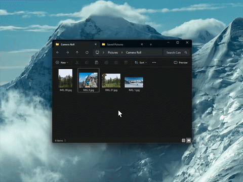
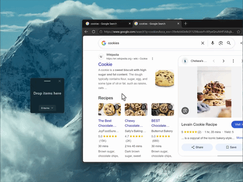
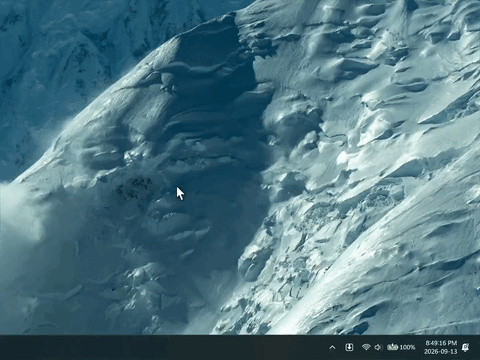

**Welcome to the issue-only repo for Dropshelf.** Dropshelf is a drag and drop utility for Windows that makes moving and copying files easier and faster. Shake your mouse to open up shelves, which let you stash and hold draggable content until you need it.

<table>
  <tr>
    <th>Drag and drop made easy</th>
    <th>Hold any content</th>
    <th>Save shelves for later</th>
  </tr>
  <tr>
    <td></td>
    <td></td>
    <td></td>
  </tr>
</table>

  <a href="https://apps.microsoft.com/detail/9MZPC6P14L7N?mode=direct">
    <picture>
      <source media="(prefers-color-scheme: dark)" srcset="https://get.microsoft.com/images/en-us%20dark.svg" width="200" />
  	  
    </picture>
  </a>

## Translations and internationalization

If you're interested in helping translate Dropshelf, [you can follow the steps outlined here.](https://github.com/williamckha/dropshelf-issues/blob/main/TRANSLATIONS.md)
